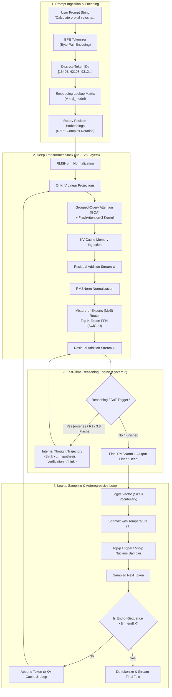
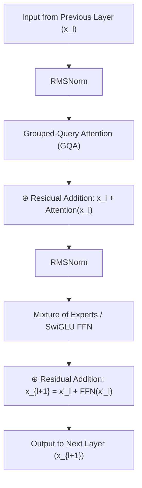
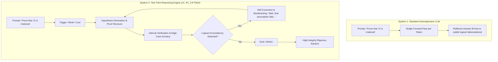
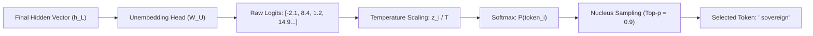

# 🧬 Modern AI Mechanics: The Anatomy of Large Language Models & Reasoning Systems

> [!IMPORTANT]
> **Executive Briefing for Sir (Harshan Sarvaiya)**  
> This master architectural document traces the complete lifecycle of an instruction: from client keystrokes and tokenization, through high-dimensional vector spaces, multi-head attention matrices, KV-cache dynamics, test-time reasoning cores, to autoregressive token synthesis, and the four-stage learning lifecycle.

---

## 🗺️ Master Architecture: The End-to-End Inference Pipeline

When you submit a prompt to modern state-of-the-art models (such as **Gemini 3.8 Flash**, **Llama 3.3**, or **GPT-4o**), it undergoes a deterministic transformation across five distinct phases:



---

## Phase 1: From Human Prose to High-Dimensional Vectors

### 1. Tokenization (Byte-Pair Encoding)
A neural network cannot understand raw text or characters directly; it operates purely on linear algebra and floating-point numbers.
- **Byte-Pair Encoding (BPE)**: Text is broken into statistical subword units using algorithms like Tiktoken or SentencePiece. Common words receive a single token (`" sovereign"` \(\rightarrow\) `[42819]`), while rare words or code snippets are split into multiple chunks (`" unsloth"` \(\rightarrow\) `[" uns", "loth"]`).
- **Special Formatting Tokens**: Modern conversational models wrap user prompts in strict control tokens:
  ```xml
  <|im_start|>system
  You are J.A.R.V.I.S., an elite sovereign assistant.<|im_end|>
  <|im_start|>user
  Analyze this architecture.<|im_end|>
  <|im_start|>assistant
  <think>
  ```

### 2. The Embedding Matrix (\(W_E\))
Each discrete token ID is mapped into a continuous vector space:
$$x_0 = \text{Embedding}(t) = W_E[t] \quad \text{where } W_E \in \mathbb{R}^{V \times d_{\text{model}}}$$
- For a model with \(d_{\text{model}} = 4,096\) (such as Llama 3 8B) and a vocabulary of 128,256 tokens, every word is represented as an array of 4,096 floating-point numbers encoding syntactic and semantic meaning.

### 3. Rotary Position Embeddings (RoPE)
Because self-attention is naturally permutation-invariant (it sees words as an unordered "bag of tokens"), the network must inject positional information.
- Modern foundation models (Llama 3, Gemini, Mistral) utilize **Rotary Position Embeddings (RoPE)** instead of additive positional sinusoidal vectors.
- **The RoPE Mechanism**: RoPE rotates the Query and Key vectors in 2D coordinate planes using complex numbers:
  $$R_{\Theta, m}^d = \text{diag}\left( R_{\theta_1, m}, R_{\theta_2, m}, \dots, R_{\theta_{d/2}, m} \right)$$
  This ensures that the dot product \(Q_m K_n^T\) depends *strictly on their relative distance* \((m - n)\), enabling dynamic context scaling (e.g., expanding from 8k to 128k+ tokens via YaRN frequency interpolation).

---

## Phase 2: Inside the Deep Transformer Stack

Modern models stack between **32 to 128 identical Transformer blocks**. Within each layer, information travels along the **Residual Stream Highway**.



### 1. RMSNorm (Root Mean Square Normalization)
Before any calculation, vectors are normalized using **RMSNorm** to stabilize gradient flow without the computational overhead of computing mean variance:
$$\text{RMSNorm}(x) = \frac{x}{\sqrt{\frac{1}{d} \sum_{i=1}^d x_i^2 + \epsilon}} \odot \gamma$$

### 2. Grouped-Query Attention (GQA) & The Attention Heatmap
Self-attention allows every token to calculate an "affinity score" with every prior token in the sequence.
- **The Q, K, V Projections**:
  - **Query (\(Q\))**: *"What information am I searching for?"*
  - **Key (\(K\))**: *"What information do I contain?"*
  - **Value (\(V\))**: *"What content do I pass along if selected?"*

$$\text{Attention}(Q, K, V) = \text{softmax}\left(\frac{Q K^T}{\sqrt{d_k}} + M\right) V$$
*(Where \(M\) is the causal mask preventing tokens from looking into the future).*

- **Grouped-Query Attention (GQA)**: In older models (Multi-Head Attention), every query head had its own \(K\) and \(V\) head. In modern GQA (used in Llama 3 and Gemini), multiple query heads (e.g., 8 heads) share a single Key-Value head. This **reduces the KV-cache memory footprint by up to 87.5%**, allowing high-throughput generation on standard GPUs.

### 3. FlashAttention-3 & The KV-Cache
- **Prefill vs. Decode**:
  1. **Prefill Phase**: The model processes your entire prompt in parallel across all GPU tensor cores.
  2. **Decode Phase**: Generating one token at a time is memory-bandwidth bound. To prevent re-calculating keys and values for past tokens, they are saved into a high-speed memory buffer called the **KV-Cache**.
- **FlashAttention-3**: Instead of materializing massive \(N \times N\) attention matrices in slow GPU HBM (High Bandwidth Memory), FlashAttention tiles the computation directly within SRAM cache, achieving a **3x–5x speedup** while maintaining exact mathematical precision.

### 4. Mixture of Experts (MoE) & SwiGLU FFN
While the Attention layer determines *which words relate to each other*, the **Feed-Forward Network (FFN)** acts as the model's **factual and reasoning database**.
- **SwiGLU Activation**:
  $$\text{SwiGLU}(x) = \left( \text{Swish}(x W_{\text{gate}}) \otimes x W_{\text{up}} \right) W_{\text{down}}$$
- **Sparsely-Gated MoE**: Frontier architectures (such as GPT-4, Gemini 1.5/3, DeepSeek) replace dense FFNs with multiple "Experts":
  - The model may possess **64 experts (total 300B+ parameters)**, but a lightweight router network activates only the **top-2 or top-8 most relevant experts (e.g., 35B active parameters)** for each specific token.
  - This delivers the encyclopedic reasoning capacity of a massive model at the execution speed and inference cost of a fraction of its size.

---

## Phase 3: The Reasoning Engine — "How It Thinks and Decides"

A profound transformation in modern AI is the divergence between **System 1 (Reflex Intuition)** and **System 2 (Deliberate Reasoning)**.



### 1. Test-Time Compute Scaling
Until recently, compute scaling was applied only during pre-training (training bigger models on more data). **Test-Time Compute** scales computation *during inference*.
- For complex code, math, or architectural planning, the model allocates tens of thousands of internal "reasoning tokens" (`<think> ... </think>`) to explore trees of thought, verify logical proofs, and backtrack when an error is detected.

### 2. Reinforcement Learning on Verifiable Trajectories (RLVR & GRPO)
How does an AI model learn to "think" and self-correct?
- Historically, human feedback (RLHF) was used, but humans are unreliable evaluators of complex logic and often reward polite, confident-sounding errors.
- Modern reasoning models utilize **RLVR (Reinforcement Learning with Verifiable Rewards)** and **GRPO (Group Relative Policy Optimization)**:
  - The model is presented with a complex problem (e.g., a LeetCode Hard problem or formal math proof).
  - It generates **\(G\) parallel reasoning rollouts**.
  - A deterministic compiler or automated test environment executes the solution:
    - Code compiles and passes all unit tests \(\rightarrow\) **Reward = +1.0**.
    - Code fails, produces runtime exception, or times out \(\rightarrow\) **Reward = 0.0**.
  - **Emergent Self-Correction**: Because the model is rewarded only for verifiable correctness, it autonomously learns to reread its previous thoughts, spot logic bugs, and re-derive proofs without human hand-crafting.

### 3. Agentic Tool Actuation (The ReAct Loop)
When J.A.R.V.I.S. interacts with your terminal, git repository, or cloud APIs, it engages a structured **ReAct (Reason + Act)** cycle:
1. **Context Appraisal**: Analyzes Sir's mandate and Upstash state.
2. **Schema-Constrained Decoding**: Constrains the logits to force syntactically valid JSON tool arguments matching the schema.
3. **Execution & Observation**: The cloud runner executes the command and injects the `stdout`/`stderr` back into the context.
4. **Reflective Synthesis**: Evaluates output against acceptance gates; if an error occurs, it diagnoses the root cause and iterates.

---

## Phase 4: Output Logits, Sampling & Autoregressive Emission

Once the final Transformer layer processes the context vector \(h_L \in \mathbb{R}^{d_{\text{model}}}\):



### 1. The Unembedding Head & Softmax
The hidden vector is projected onto the entire vocabulary via the unembedding matrix \(W_U \in \mathbb{R}^{d_{\text{model}} \times V}\), producing a vector of unnormalized scores (logits):
$$z = h_L W_U$$
The logits are transformed into a probability distribution via Softmax with Temperature \(T\):
$$P(w_i) = \frac{\exp(z_i / T)}{\sum_{j=1}^V \exp(z_j / T)}$$
- **Temperature (\(T\))**:
  - \(T \rightarrow 0\) (Greedy Decoding): Picks the absolute highest-probability token. Ideal for deterministic code and mathematics.
  - \(T \approx 0.7 - 1.0\): Flattens the probability curve, introducing controlled creative exploration and linguistic variance.

### 2. Nucleus Sampling (Top-\(p\)) & Min-\(p\)
- **Top-\(p\) Sampling**: Instead of considering all 128,000 tokens, the sampler truncates the pool to the smallest set of tokens whose cumulative probability exceeds \(p\) (e.g., \(p = 0.90\)). This cuts off the long tail of irrational or nonsensical tokens.
- **Min-\(p\) Sampling**: An advanced alternative that dynamically scales the cutoff threshold relative to the top token's probability: any token with \(P(w_i) < \text{Min\_p} \times P(w_{\text{top}})\) is pruned.

### 3. Speculative Decoding
To generate tokens faster than memory bandwidth allows:
- A tiny draft model (e.g., a 1B distilled SLM) rapidly speculates 4–5 candidate tokens in sequence.
- The massive frontier model verifies all 5 tokens in a **single parallel forward pass**.
- If tokens 1, 2, and 3 match the frontier model's distribution, they are accepted instantly, achieving **2x–3x higher generation speeds** with zero degradation in intelligence.

---

## Phase 5: How AI Learns — The 4-Stage Training Lifecycle

An AI model is not born intelligent; it is forged across four successive stages:

```mermaid
timeline
    title The 4 Stages of AI Training
    section 1. Pre-Training : Self-Supervised Next-Token Prediction : 15 - 30 Trillion Tokens : Massive GPU Clusters (Thousands of H100s) : Builds World Knowledge & Grammar
    section 2. SFT : Supervised Fine-Tuning : 50k - 500k Curated Pairs : Teaches Conversational Compliance : Transforms Autocomplete into Assistant
    section 3. Alignment : Direct Preference Optimization (DPO) : RLHF with Human / AI Feedback : Establishes Ethical Guardrails & Tone
    section 4. Post-Training RL : RLVR & Reasoning Distillation : Verifiable Rewards in Code / Math : Forges Chain-of-Thought & Self-Correction
```

### 1. Pre-Training (The Foundation of World Knowledge)
- **Objective**: Predict the very next token in a sequence given all preceding tokens:
  $$\mathcal{L}_{\text{pre}}(\theta) = -\sum_{t=1}^N \log P_\theta(x_t \mid x_{<t})$$
- **Scale**: Trained on **15 to 30 trillion tokens** of diverse internet text, books, research papers, GitHub repositories, and mathematical proofs.
- **Compute Infrastructure**: Requires clusters of 16,000+ NVIDIA H100 / B200 GPUs interconnected via 3.2 Tbps InfiniBand networks, utilizing 3D Parallelism (Tensor, Pipeline, and ZeRO-3 Data Parallelism).
- **Outcome**: The model acquires a world model, linguistic grammar, programming logic, and encyclopedic facts, but behaves as an unruly document-completion engine rather than a helpful agent.

### 2. Supervised Fine-Tuning (SFT / Instruction Tuning)
- **Objective**: Teach the base model how to respond as a helpful, structured conversational entity.
- **Data**: Hundreds of thousands of meticulously engineered prompt-response dialogues demonstrating role adherence, formatting constraints, and step-by-step problem-solving.

### 3. Alignment: RLHF & Direct Preference Optimization (DPO)
To align the model with human values, eliminate toxic outputs, and enforce executive conciseness:
- **Direct Preference Optimization (DPO)**: Rather than training an error-prone auxiliary reward model (as in legacy RLHF), DPO optimizes the neural weights directly using pairs of winning (\(y_w\)) and losing (\(y_l\)) responses:
  $$\mathcal{L}_{\text{DPO}}(\theta; \pi_{\text{ref}}) = -\mathbb{E}_{(x, y_w, y_l)} \left[ \log \sigma \left( \beta \log \frac{\pi_\theta(y_w \mid x)}{\pi_{\text{ref}}(y_w \mid x)} - \beta \log \frac{\pi_\theta(y_l \mid x)}{\pi_{\text{ref}}(y_l \mid x)} \right) \right]$$

### 4. Reasoning & Knowledge Distillation (The Sovereign Edge)
- **RL with Verifiable Rewards (RLVR)**: Elevates the aligned model into a self-checking reasoning powerhouse.
- **Knowledge Distillation**: The reasoning trajectories, chain-of-thought protocols, and tool schemas of giant frontier models are distilled into compact student models (such as our planned **`JARVIS-Sovereign-1`**), allowing a 3B model to inherit the high-level cognitive patterns of a 70B+ cluster.
