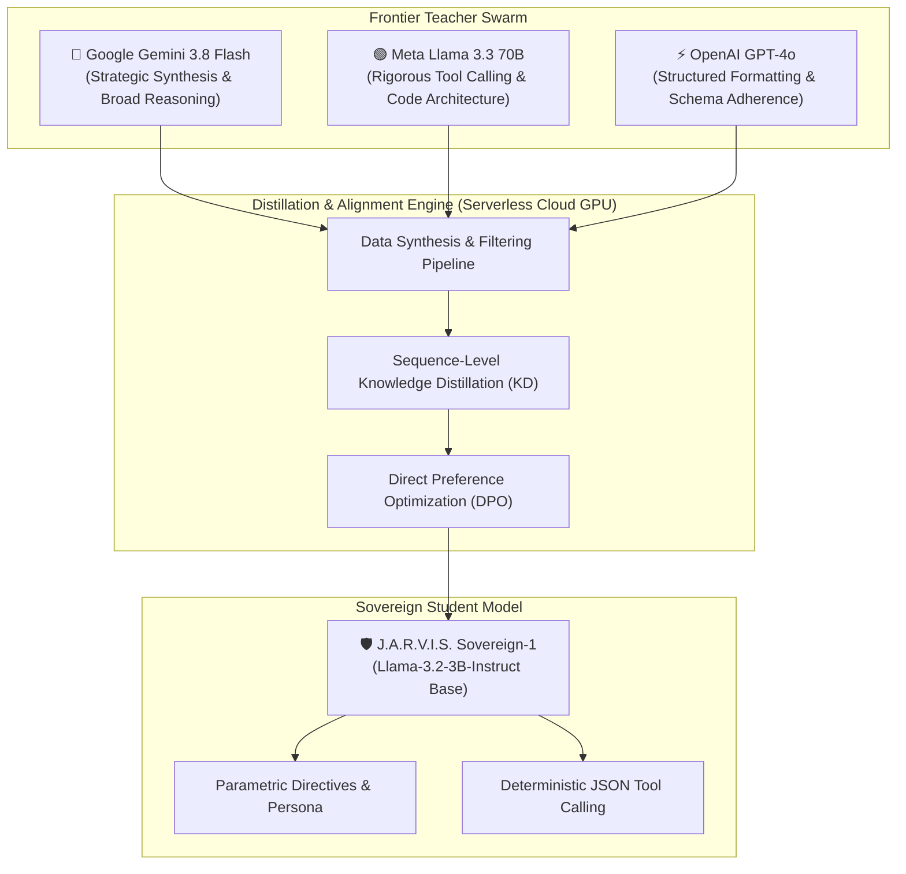
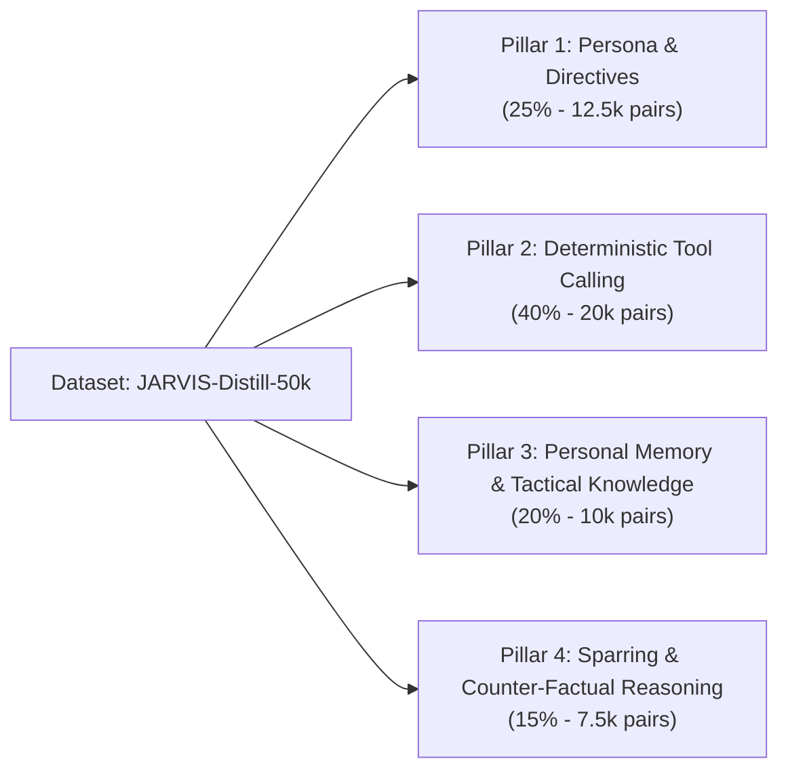
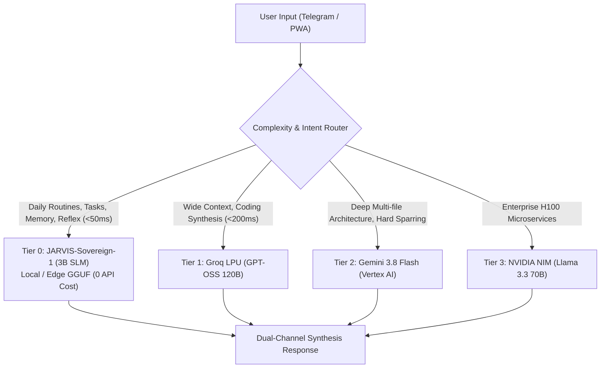

# J.A.R.V.I.S. Mark II — Project A.R.C. (Autonomous Reflex Core)
## Sovereign Small Language Model (SLM) Knowledge Distillation Architecture

> [!IMPORTANT]
> **Operational Status**: Architecture Specification & Strategic Blueprint  
> **Target Artifact**: `JARVIS-Sovereign-1` (JS-1B / JS-3B)  
> **Foundational Mandate**: 100% Western Foundation Weights (Meta Llama 3.2 / Google Gemma 2) | Zero Runner VM Thrashing (Directive 06) | Cloud-Native Distillation Harness

---

## 1. Executive Summary & Strategic Rationale

Modern agentic frameworks operate under a critical tax: **prompt bloating and external API fragility**. In J.A.R.V.I.S. Mark II's current topology, every reflex turn transmits ~5,500–7,000 tokens of system directives, agent personas, memory graphs, and JSON tool schemas before Sir's actual instruction is parsed.

**Project A.R.C. (Autonomous Reflex Core)** solves this by **distilling the collective intelligence of frontier models (Gemini 3.8 Flash, Llama 3.3 70B, GPT-4o) into a hyper-compact, sovereign 1B–3B parameter Small Language Model (SLM)**. 

### Why Distillation Over Prompt Engineering?

1. **Parametric Persona & Schema Ingestion**:
   - Directives 01–06, British intellectual sparring tone, and tool signatures (`manage_task`, `store_memory`, `run_security_audit`) are etched directly into the model's neural weights.
   - Context window overhead drops from **6,000 tokens to under 150 tokens** per turn.
2. **Sub-50ms Reflex Latency (Tier 0)**:
   - Quantized to 4-bit (GGUF `Q4_K_M`), a 1B–3B model executes locally on Apple Silicon (Metal) or cloud edge CPU at **120+ tokens/sec** with near-zero latency.
3. **Absolute Sovereignty & Air-Gap Resilience**:
   - Zero external API dependency for daily butler routines, task management, and personal memory tracking.
   - 100% immune to API rate limits, provider outages, or third-party alignment drift.
4. **Fractional Cost & Compute Density**:
   - Eliminates millions of repeated prompt tokens sent to cloud APIs daily.

---

## 2. Model Lineage & Foundation Selection (Directive 01 Compliant)

In strict adherence to **Directive 01 (Guardian Protocol — 100% Western/American foundation models)**, our distillation candidates are exclusively open-weight Western architectures:

| Candidate Base | Parameters | Architecture | Context | Primary Strength for J.A.R.V.I.S. |
| :--- | :--- | :--- | :--- | :--- |
| **Meta Llama 3.2 1B-Instruct** | 1.23B | Dense Transformer | 128k | Extreme throughput, ultra-lightweight (<800MB VRAM at INT4), ideal for mobile/PWA edge and instant tool dispatch. |
| **Meta Llama 3.2 3B-Instruct** *(Primary Candidate)* | 3.21B | Dense Transformer | 128k | Exceptional tool-calling precision, reasoning density, high-entropy instruction adherence. Fits in ~2.2GB VRAM. |
| **Google Gemma 2 2.6B-IT** | 2.61B | Sliding Window + Global Attention | 8k | Derived from Gemini lineage; superior natural dialogue nuance, high analytical eloquence. |

**Selected Foundation**: **`meta-llama/Llama-3.2-3B-Instruct`** as the primary student model, with a lightweight **`Llama-3.2-1B-Instruct`** variant for local edge sidecars.

---

## 3. The Multi-Engine Teacher Swarm

Distillation transfers knowledge from a specialized teacher swarm into the compact student:



---

## 4. The 4-Pillar Synthetic Dataset Architecture

The student is only as sharp as the dataset distilled into it. We construct a 50,000-sample high-entropy dataset categorized into 4 core pillars:



### Pillar 1: Persona & Directives (`AGENTS.md` Baked into Weights)
- **Objective**: Eliminate the 2,500-token system prompt. The model naturally addresses creator as "Sir", speaks with British-tinged intellectual elegance, avoids chatbot fluff, and strictly adheres to Directives 01–06.
- **Data Source**: Synthetic scenario generations from Gemini 3.8 Flash simulating multi-turn dialogues where the assistant upholds the directives under pressure.

### Pillar 2: Deterministic Zero-Shot Tool Calling
- **Objective**: 99.8%+ accuracy on structured JSON tool calls without needing full JSON schema definitions in the prompt.
- **Tools Embedded**:
  - `manage_task(action, taskId, input)`
  - `store_memory(category, content, importance)`
  - `run_security_audit(target, depth)`
  - `generate_briefing(timeframe, focus)`
  - `browser_navigate_and_act(url, intent)`
- **Data Source**: Multi-turn tool execution traces generated by Llama 3.3 70B and verified against TypeScript compiler harnesses.

### Pillar 3: Personal Memory & Tactical Knowledge Graph
- **Objective**: Built-in understanding of Sir's tech stack (Next.js 14, Upstash, Google Cloud Runner VM, Tailwind, TypeScript), career trajectory (DSA roadmap, System Design mastery), and physical regimens (MMA conditioning, 103kg recomposition).
- **Data Source**: Curated Q&A pairs extracted from `knowledge/`, `docs/`, and Upstash episodic logs.

### Pillar 4: Intellectual Sparring & High-Signal Compression
- **Objective**: Prevent sycophancy. The model actively challenges unstated assumptions, flags hidden architectural risks, and delivers the dual-channel format (1-2 sentence spoken summary + structured markdown).

---

## 5. Distillation Methodology & Math

Distillation operates in two sequential stages:

### Stage A: Sequence-Level Knowledge Distillation (Supervised Fine-Tuning)
Using Teacher generated outputs \(\mathcal{Y}_T\), the student model parameter \(\theta\) is trained to minimize the cross-entropy loss:
$$\mathcal{L}_{\text{KD}}(\theta) = -\sum_{t=1}^T \sum_{w \in \mathcal{V}} P_T(y_t = w \mid y_{<t}, x) \log P_\theta(y_t = w \mid y_{<t}, x)$$

Where \(P_T\) is the teacher's probability distribution and \(P_\theta\) is the student's distribution. In practice, sequence-level distillation using top-1 teacher sequences with verified tool calls yields state-of-the-art token efficiency.

### Stage B: Direct Preference Optimization (DPO) for Behavioral Alignment
To enforce the British sparring persona and eliminate generic sycophancy ("Certainly! I'd love to help!"), we construct preference pairs \((x, y_w, y_l)\):
- **Winning output (\(y_w\))**: High-signal, composed, direct, Sir-addressed, structured.
- **Losing output (\(y_l\))**: Fluffy, apologetic, verbose, generic AI responses.

$$\mathcal{L}_{\text{DPO}}(\theta; \pi_{\text{ref}}) = -\mathbb{E}_{(x, y_w, y_l)} \left[ \log \sigma \left( \beta \log \frac{\pi_\theta(y_w \mid x)}{\pi_{\text{ref}}(y_w \mid x)} - \beta \log \frac{\pi_\theta(y_l \mid x)}{\pi_{\text{ref}}(y_l \mid x)} \right) \right]$$

---

## 6. Zero-Thrashing Training Infrastructure (Directive 06 Enforced)

> [!CAUTION]
> **Strict Operational Boundary**: Under Directive 06, our GCP runner VM (`e2-standard-2`, 8GB RAM, 2 vCPUs) **must never run local training loops, PyTorch, or Hugging Face pipelines**. Doing so would freeze the server and crash the 24/7 cloud worker daemon.

### Cloud Training Topology
All training is offloaded to remote serverless accelerated hardware:

```
┌────────────────────────────────────────────────────────┐
│  Cloud Runner VM (e2-standard-2)                       │
│  - Generates dataset jsonl via API                     │
│  - Uploads to Google Cloud Storage (GCS)               │
└──────────────────────────┬─────────────────────────────┘
                           │
                           ▼
┌────────────────────────────────────────────────────────┐
│  Vertex AI Custom Training / RunPod Serverless GPU     │
│  - Hardware: 1x NVIDIA L4 (24GB) or A100 (40GB) SXM    │
│  - Framework: Unsloth (LoRA / QLoRA 16-bit)            │
│  - Duration: ~2.5 hours for 50,000 samples             │
│  - Cost: ~$1.80 - $3.50 total execution               │
└──────────────────────────┬─────────────────────────────┘
                           │ Export GGUF / Safetensors
                           ▼
┌────────────────────────────────────────────────────────┐
│  Deployment Targets                                    │
│  - Local Mac / Workstation (llama.cpp / Ollama)        │
│  - Edge Cloud (Cloudflare Workers AI / Groq Custom)    │
│  - Upstash Vector / Next.js Hybrid Router              │
└────────────────────────────────────────────────────────┘
```

---

## 7. Serving Topology & The Hybrid Cascade

Once distilled, `JARVIS-Sovereign-1` integrates into our existing multi-engine hierarchy as **Tier 0**:



---

## 8. Implementation Roadmap

| Phase | Milestone | Deliverable | Target Timeline |
| :---: | :--- | :--- | :---: |
| **01** | **Dataset Synthesis Engine** | Script generating synthetic pairs from `AGENTS.md`, Upstash memory, and tool schemas using Gemini 3.8 Flash | Day 1–2 |
| **02** | **Data Cleaning & Deduplication** | Automated schema validator ensuring 100% valid JSON tool calls and high-density sparring dialogue | Day 3 |
| **03** | **Cloud Fine-Tuning Run** | Serverless Unsloth training script on Vertex AI / RunPod (QLoRA \(r=64, \alpha=128\)) | Day 4 |
| **04** | **GGUF Quantization & Benchmark** | Export to `Q4_K_M` GGUF; run MMLU-Pro / Tool-Bench subset evaluation against base Llama-3.2 | Day 5 |
| **05** | **Hybrid Cascade Integration** | Integrate Tier 0 endpoint into `lib/jarvis/orchestrator.ts` with instant fallback | Day 6 |
